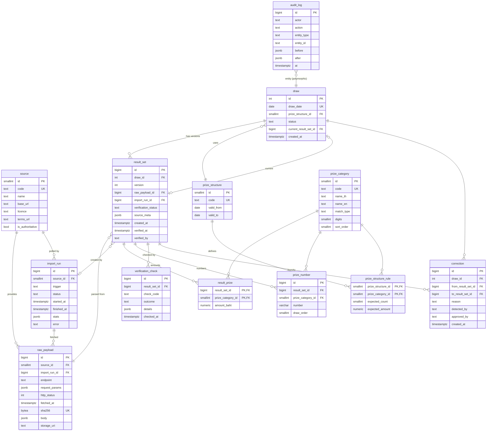

# Phase 3 — Database Design

Target: PostgreSQL 16. Status: **Proposal, awaiting review.**

## 1. Design principles

1. **Immutable result versions.** Imported results are never updated in place. Each import that changes data creates a new `result_set` version, and the `draw` row points to the current one. This one mechanism gives versioning, corrections and auditability together.
2. **Raw first.** Every upstream response is stored (`raw_payload`) before it is parsed. Any parsed row can be traced back to the exact bytes it came from.
3. **Data-driven prize rules.** Categories, match rules, expected counts and amounts live in tables that are keyed by **prize-structure era**, not hard-coded. The research found that the structure changed around 2015.
4. **Normalised to 3NF.** The only exception is `draw.current_result_set_id`, a deliberate pointer for fast reads.
5. **UTC timestamps** (`timestamptz`). Draw dates are a plain `date` (Thailand has a single timezone, ICT).

## 2. ERD



## 3. DDL (proposed)

```sql
-- ===== Reference data ==========================================
CREATE TABLE source (
  id               smallint GENERATED ALWAYS AS IDENTITY PRIMARY KEY,
  code             text NOT NULL UNIQUE,              -- 'glo_api'
  name             text NOT NULL,
  base_url         text NOT NULL,
  licence          text NOT NULL,                     -- 'CC Non-Commercial (Any) per gdcatalog dataset_c4-9_01'
  terms_url        text,
  is_authoritative boolean NOT NULL DEFAULT false,
  created_at       timestamptz NOT NULL DEFAULT now()
);

CREATE TYPE match_type AS ENUM ('EXACT6','PREFIX3','SUFFIX3','SUFFIX2');

CREATE TABLE prize_category (
  id         smallint GENERATED ALWAYS AS IDENTITY PRIMARY KEY,
  code       text NOT NULL UNIQUE,                    -- first, second, ..., near1, last3f, last3b, last2
  name_th    text NOT NULL,
  name_en    text NOT NULL,
  match_type match_type NOT NULL,
  digits     smallint NOT NULL CHECK (digits IN (2,3,6)),
  sort_order smallint NOT NULL,
  CHECK ((match_type = 'EXACT6'  AND digits = 6) OR
         (match_type IN ('PREFIX3','SUFFIX3') AND digits = 3) OR
         (match_type = 'SUFFIX2' AND digits = 2))
);

CREATE TABLE prize_structure (                         -- "era"
  id         smallint GENERATED ALWAYS AS IDENTITY PRIMARY KEY,
  code       text NOT NULL UNIQUE,                    -- 'legacy_last3x4', 'modern_front3_back3'
  valid_from date NOT NULL,
  valid_to   date,                                    -- NULL = current
  CHECK (valid_to IS NULL OR valid_to > valid_from)
);
-- Non-overlap of eras (requires btree_gist):
-- ALTER TABLE prize_structure ADD EXCLUDE USING gist (daterange(valid_from, valid_to) WITH &&);

CREATE TABLE prize_structure_rule (
  prize_structure_id smallint NOT NULL REFERENCES prize_structure(id),
  prize_category_id  smallint NOT NULL REFERENCES prize_category(id),
  expected_count     smallint NOT NULL CHECK (expected_count >= 0),
  expected_amount    numeric(14,2),                   -- NULL = unknown (historical amounts unverified)
  PRIMARY KEY (prize_structure_id, prize_category_id)
);

-- ===== Ingestion provenance ====================================
CREATE TABLE import_run (
  id          bigint GENERATED ALWAYS AS IDENTITY PRIMARY KEY,
  source_id   smallint NOT NULL REFERENCES source(id),
  trigger     text NOT NULL CHECK (trigger IN ('schedule','drawday','reconcile','backfill','manual')),
  status      text NOT NULL CHECK (status IN ('RUNNING','SUCCEEDED','SKIPPED','FAILED')),
  started_at  timestamptz NOT NULL DEFAULT now(),
  finished_at timestamptz,
  stats       jsonb NOT NULL DEFAULT '{}',            -- {"fetched":1,"new_versions":0,...}
  error       text
);
CREATE INDEX import_run_started_idx ON import_run (started_at DESC);

CREATE TABLE raw_payload (
  id             bigint GENERATED ALWAYS AS IDENTITY PRIMARY KEY,
  source_id      smallint NOT NULL REFERENCES source(id),
  import_run_id  bigint REFERENCES import_run(id),
  endpoint       text NOT NULL,                       -- 'getLotteryResult'
  request_params jsonb NOT NULL,                      -- {"date":"01","month":"03","year":"2024"}
  http_status    int NOT NULL,
  fetched_at     timestamptz NOT NULL,
  sha256         bytea NOT NULL,
  body           jsonb,                               -- JSON responses (~6 KB each)
  storage_uri    text,                                -- PDFs / non-JSON in object storage
  UNIQUE (source_id, endpoint, request_params, sha256) -- identical response to identical request stored once
);                                                     -- (request_params included: "response":null bodies are identical across dates)
-- Note: fetches that return an identical body are recorded in import_run.stats, not as new rows.

-- ===== Draws & versioned results ===============================
CREATE TABLE draw (
  id                    int GENERATED ALWAYS AS IDENTITY PRIMARY KEY,
  draw_date             date NOT NULL UNIQUE,
  prize_structure_id    smallint NOT NULL REFERENCES prize_structure(id),
  status                text NOT NULL DEFAULT 'SCHEDULED'
                        CHECK (status IN ('SCHEDULED','PUBLISHED','POSTPONED','CANCELLED')),
  current_result_set_id bigint,                       -- FK added below (circular)
  created_at            timestamptz NOT NULL DEFAULT now(),
  updated_at            timestamptz NOT NULL DEFAULT now()
);
CREATE INDEX draw_published_date_idx ON draw (draw_date DESC) WHERE status = 'PUBLISHED';

CREATE TYPE verification_status AS ENUM ('PENDING','VERIFIED','QUARANTINED','REJECTED');

CREATE TABLE result_set (
  id                  bigint GENERATED ALWAYS AS IDENTITY PRIMARY KEY,
  draw_id             int NOT NULL REFERENCES draw(id),
  version             int NOT NULL CHECK (version >= 1),
  raw_payload_id      bigint NOT NULL REFERENCES raw_payload(id),
  import_run_id       bigint REFERENCES import_run(id),
  verification_status verification_status NOT NULL DEFAULT 'PENDING',
  source_meta         jsonb NOT NULL DEFAULT '{}',    -- period, sheetId, pdf_url, youtube_url (stored raw)
  content_hash        bytea NOT NULL,                 -- hash of canonical numbers+amounts; detects real changes
  created_at          timestamptz NOT NULL DEFAULT now(),
  verified_at         timestamptz,
  verified_by         text,                           -- 'auto' | operator id
  UNIQUE (draw_id, version),
  UNIQUE (draw_id, content_hash)                      -- same content never versioned twice
);

ALTER TABLE draw ADD CONSTRAINT draw_current_rs_fk
  FOREIGN KEY (current_result_set_id) REFERENCES result_set(id) DEFERRABLE INITIALLY DEFERRED;

CREATE TABLE result_prize (
  result_set_id     bigint   NOT NULL REFERENCES result_set(id) ON DELETE RESTRICT,
  prize_category_id smallint NOT NULL REFERENCES prize_category(id),
  amount_baht       numeric(14,2) NOT NULL CHECK (amount_baht >= 0),
  PRIMARY KEY (result_set_id, prize_category_id)
);

CREATE TABLE prize_number (
  id                bigint GENERATED ALWAYS AS IDENTITY PRIMARY KEY,
  result_set_id     bigint   NOT NULL REFERENCES result_set(id) ON DELETE RESTRICT,
  prize_category_id smallint NOT NULL REFERENCES prize_category(id),
  number            varchar(6) NOT NULL CHECK (number ~ '^[0-9]{2,6}$'),
  draw_order        smallint,                         -- GLO "round"
  UNIQUE (result_set_id, prize_category_id, number)
);
CREATE INDEX prize_number_rs_idx ON prize_number (result_set_id);
-- Optional (for "has this number ever won?" feature):
-- CREATE INDEX prize_number_number_idx ON prize_number (number);
-- Digit-length per category is enforced in the validation layer + a trigger (see §5).

CREATE TABLE verification_check (
  id            bigint GENERATED ALWAYS AS IDENTITY PRIMARY KEY,
  result_set_id bigint NOT NULL REFERENCES result_set(id),
  check_code    text NOT NULL,                        -- 'schema','counts','near1','cross_glo_check',...
  outcome       text NOT NULL CHECK (outcome IN ('PASS','WARN','FAIL')),
  details       jsonb NOT NULL DEFAULT '{}',
  checked_at    timestamptz NOT NULL DEFAULT now()
);
CREATE INDEX verification_check_rs_idx ON verification_check (result_set_id);

CREATE TABLE correction (
  id                 bigint GENERATED ALWAYS AS IDENTITY PRIMARY KEY,
  draw_id            int    NOT NULL REFERENCES draw(id),
  from_result_set_id bigint NOT NULL REFERENCES result_set(id),
  to_result_set_id   bigint NOT NULL REFERENCES result_set(id),
  reason             text NOT NULL,
  detected_by        text NOT NULL CHECK (detected_by IN ('reconcile','validator','operator','public_report')),
  approved_by        text NOT NULL,
  created_at         timestamptz NOT NULL DEFAULT now(),
  CHECK (from_result_set_id <> to_result_set_id)
);

-- ===== Audit ===================================================
CREATE TABLE audit_log (
  id          bigint GENERATED ALWAYS AS IDENTITY PRIMARY KEY,
  actor       text NOT NULL,                          -- 'worker', 'admin:<name>'
  action      text NOT NULL,                          -- 'result_set.verify', 'draw.set_current', ...
  entity_type text NOT NULL,
  entity_id   text NOT NULL,
  before      jsonb,
  after       jsonb,
  at          timestamptz NOT NULL DEFAULT now()
);
CREATE INDEX audit_log_entity_idx ON audit_log (entity_type, entity_id, at DESC);
```

## 4. Seed data

`prize_category` (codes match the GLO payload keys):

| code | name_en | match_type | digits |
|---|---|---|---|
| first | First prize | EXACT6 | 6 |
| near1 | Adjacent to first prize | EXACT6 | 6 |
| second | Second prize | EXACT6 | 6 |
| third | Third prize | EXACT6 | 6 |
| fourth | Fourth prize | EXACT6 | 6 |
| fifth | Fifth prize | EXACT6 | 6 |
| last3f | First three digits | PREFIX3 | 3 |
| last3b | Last three digits | SUFFIX3 | 3 |
| last2 | Last two digits | SUFFIX2 | 2 |

`prize_structure` and its rules (expected counts **observed** in the GLO API, see the research doc §3.3):

| era | first | near1 | second | third | fourth | fifth | last3f | last3b | last2 |
|---|---|---|---|---|---|---|---|---|---|
| legacy (≤ 2015-01-16 observed) | 1 | 2 | 5 | 10 | 50 | 100 | 0 | 4 | 1 |
| modern (≥ 2020-01-17 observed) | 1 | 2 | 5 | 10 | 50 | 100 | 2 | 2 | 1 |

The boundary between the eras is **unconfirmed** and has to be pinned during backfill. The backfill job finds the first draw where `last3f` count > 0. `expected_amount` is set only for the modern era (6,000,000 / 100,000 / 200,000 / 80,000 / 40,000 / 20,000 / 4,000 / 4,000 / 2,000). Legacy amounts stay NULL until they are verified.

## 5. Integrity rules not expressible as simple constraints

Enforce these in the validation layer and back them with a trigger:

- `prize_number.number` length = `prize_category.digits` (trigger `BEFORE INSERT`).
- The number of rows per category in a result_set = `prize_structure_rule.expected_count` for the draw's era. Checked by the validator, and as a deferred constraint trigger at commit.
- `draw.current_result_set_id` must reference a result_set of the **same draw** with status `VERIFIED` (trigger).
- `result_set`, `result_prize` and `prize_number` are **append-only**. A trigger rejects UPDATE and DELETE on them, except updates to `result_set.verification_status`, `verified_at` and `verified_by`.

## 6. Transactions

**Import (one transaction per draw):**
```
BEGIN;
  INSERT raw_payload ... ON CONFLICT (source_id, endpoint, request_params, sha256) DO NOTHING RETURNING id;  -- or SELECT existing
  SELECT ... FROM draw WHERE draw_date = $1 FOR UPDATE;          -- serialise concurrent imports per draw
  -- compute content_hash; if equals current version's hash → record "unchanged" in import_run.stats, COMMIT
  INSERT result_set (version = coalesce(max(version),0)+1, verification_status='PENDING') ...;
  INSERT result_prize ...; INSERT prize_number ...;
  INSERT verification_check ... (per check);
  -- if all PASS and it is the first version: status → VERIFIED, draw.current_result_set_id = new id
  -- if a VERIFIED version already exists and content differs → status QUARANTINED (correction candidate)
  INSERT audit_log ...;
COMMIT;
```
- Isolation: READ COMMITTED plus the row lock on `draw` is enough. The cross-source check (an HTTP call) runs **before** the transaction starts, so no transaction stays open across network I/O.

**Approving a correction (admin CLI):** one transaction that does all of the following:
- sets the new result_set to `VERIFIED`,
- inserts a `correction` row,
- repoints `draw.current_result_set_id`,
- writes `audit_log`,

then purges the CDN after commit.

## 7. Query patterns and indexes

| Query | Path |
|---|---|
| Latest draw | `draw_published_date_idx` → `current_result_set_id` → `prize_number_rs_idx` (about 175 rows) |
| Draw by date | `draw.draw_date` UNIQUE index |
| List by year | Range scan on `draw_published_date_idx` |
| Check numbers | Load the draw's numbers once (cached in memory) and match in application code. No DB index is needed |
| Version history | `result_set (draw_id, version)` UNIQUE index |
| Audit trail of an entity | `audit_log_entity_idx` |

Size: about 175 `prize_number` rows per draw × about 24/yr × 16 yr ≈ 70k rows, plus about 400 raw payloads of roughly 6 KB each, so a few MB in total. Partitioning is not needed.

## 8. Retention and privacy

- Raw payloads, result sets, corrections and audit logs are kept **forever**. They are small, and keeping them is the point of the design.
- No user data is stored. Number checks are not persisted. If check statistics are added later, store only aggregate daily counts.
