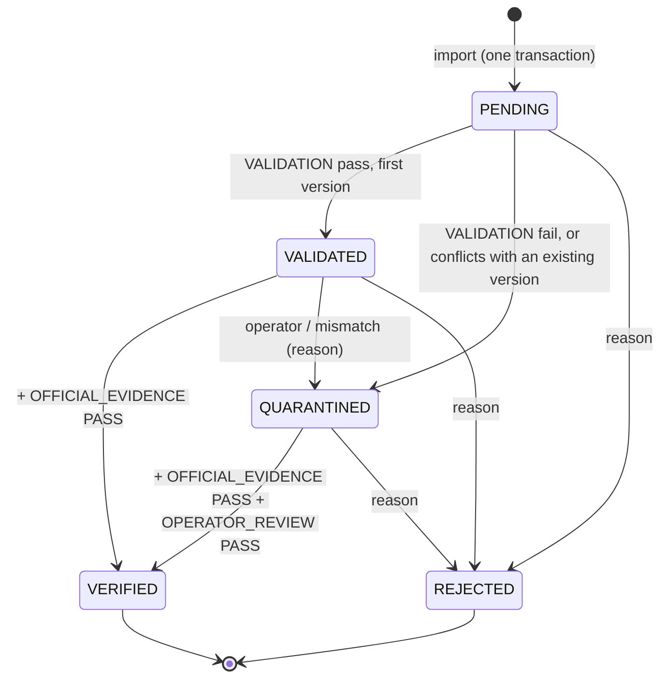

# Database Design (as implemented in M3)

Target: **PostgreSQL 17**. Driver: `pg`. ORM / migrations: Drizzle ORM 0.45 + drizzle-kit 0.31.

> **Revision note.** This document describes the schema as implemented in M3. It was revised under
> [ADR-0002](../adr/0002-database-design-revisions.md) (D1–D7, verification lifecycle, roles).
> The original pre-M3 design is preserved in Git history at commit `7f1d532`.

Source of truth for the schema:
- `packages/db/src/schema.ts` (Drizzle)
- `packages/db/migrations/0000_init.sql` (generated)
- `0001_integrity_triggers.sql`, `0002_reference_data.sql`, `0003_role_grants.sql` (hand-written)

## 1. Design principles

1. **Immutable result versions.** Imported results are never updated in place. Each import whose content changed creates a new `result_set` version. `draw.current_result_set_id` points at the published, VERIFIED one.
2. **Raw first, byte-exact.** Every upstream response is stored as exact bytes with a verified SHA-256 before it is parsed. It is kept even if parsing or import later fails.
3. **Validation ≠ verification.** Passing the schema and validation rules makes a result **VALIDATED** only. **VERIFIED** requires official evidence (see §4).
4. **Data-driven prize rules, no fixed amounts.** Categories and expected counts are keyed by prize structure. Amounts exist only per draw and may be NULL.
5. **Integrity in the database.** Append-only behaviour, lifecycle rules, same-draw references and the audit trail are enforced by constraints and triggers that bind every role. Privileges add a second layer for runtime roles.
6. **UTC timestamps** (`timestamptz`); draw dates are a plain `date`.

## 2. ERD

```mermaid
erDiagram
  source ||--o{ import_run : "polled by"
  source ||--o{ raw_payload : "provides"
  import_run |o--o{ raw_payload : "fetched"
  import_run |o--o{ result_set : "created"
  raw_payload ||--o{ result_set : "parsed into"
  draw ||--o{ result_set : "versions"
  draw |o--o| result_set : "current (same draw, VERIFIED)"
  prize_structure ||--o{ result_set : "structure of"
  prize_structure ||--o{ prize_structure_rule : "defines"
  prize_category ||--o{ prize_structure_rule : ""
  result_set ||--o{ result_prize : "amounts"
  prize_category ||--o{ result_prize : ""
  result_prize ||--o{ prize_number : "numbers"
  result_set ||--o{ verification_check : "evidence"
  draw ||--o{ correction : ""
  result_set ||--o{ correction : "from / to (same draw)"

  source { smallint id PK; text code UK; text name; text base_url; text licence; text terms_url; bool is_authoritative }
  import_run { bigint id PK; smallint source_id FK; text trigger; text status; timestamptz started_at; timestamptz finished_at; jsonb stats; text error }
  raw_payload { bigint id PK; smallint source_id FK; bigint import_run_id FK; text endpoint; text request_method; jsonb request_params; int http_status; timestamptz fetched_at; text content_type; jsonb response_headers; bytea body_bytes; int byte_size; bytea sha256; jsonb body_json; text provenance }
  prize_category { smallint id PK; text code UK; text name_th; text name_en; match_type match_type; smallint digits; smallint sort_order UK }
  prize_structure { smallint id PK; text code UK; text description; date first_observed_draw; date last_observed_draw }
  prize_structure_rule { smallint prize_structure_id PK; smallint prize_category_id PK; smallint expected_count }
  draw { int id PK; date draw_date UK; text status; bigint current_result_set_id FK; timestamptz created_at; timestamptz updated_at }
  result_set { bigint id PK; int draw_id FK; int version; smallint prize_structure_id FK; bigint raw_payload_id FK; bigint import_run_id FK; bytea content_hash; verification_status verification_status; text status_reason; timestamptz verified_at; text verified_by }
  result_prize { bigint result_set_id PK; smallint prize_category_id PK; numeric amount_baht "nullable" }
  prize_number { bigint id PK; bigint result_set_id FK; smallint prize_category_id FK; varchar number; smallint draw_order }
  verification_check { bigint id PK; bigint result_set_id FK; check_kind check_kind; text check_code; check_outcome outcome; jsonb details; text evidence_ref; text performed_by; timestamptz checked_at }
  correction { bigint id PK; int draw_id FK; bigint from_result_set_id FK; bigint to_result_set_id FK; text reason; text detected_by; text approved_by }
  audit_log { bigint id PK; text actor; text db_role; text action; text entity_type; text entity_id; jsonb before; jsonb after; timestamptz at }
```

## 3. Tables and constraints

| Table | Key constraints |
|---|---|
| `source` | `code` UNIQUE. Seeded with `glo_api` (licence noted as unconfirmed) |
| `prize_category` | `code`, `sort_order` UNIQUE. CHECK `match_type`↔`digits` (EXACT6→6, PREFIX3/SUFFIX3→3, SUFFIX2→2). Seed data equals `@lekvero/shared` (tested) |
| `prize_structure` | `code` UNIQUE. Observed dates are informational only (D1) |
| `prize_structure_rule` | PK (structure, category). `expected_count ≥ 0`. **No amounts** (D2) |
| `import_run` | CHECK trigger ∈ {schedule, drawday, reconcile, backfill, manual, fixture}. CHECK status ∈ {RUNNING, SUCCEEDED, SKIPPED, FAILED}. `finished_at` set iff not RUNNING. Only RUNNING rows change; never deleted |
| `raw_payload` | UNIQUE (source, endpoint, request_params, sha256). CHECK `byte_size = octet_length(body_bytes) ≤ 1 MiB`. CHECK `sha256 = sha256(body_bytes)`. CHECK response headers contain none of `set-cookie`, `cookie`, `authorization`, `proxy-authorization`, `x-api-key`. Provenance required. Append-only |
| `draw` | `draw_date` UNIQUE. CHECK status. CHECK pointer ⇒ `PUBLISHED`. FK `(id, current_result_set_id)` → `result_set(draw_id, id)` (same draw). Never deleted |
| `result_set` | UNIQUE (draw_id, version) and (draw_id, id). `version ≥ 1`. 32-byte `content_hash`. CHECK VERIFIED ⇔ `verified_at` and `verified_by` set. CHECK QUARANTINED/REJECTED ⇒ non-empty reason. Content columns immutable; never deleted |
| `result_prize` | PK (result_set, category). `amount_baht ≥ 0` or NULL (D3). Category must be in the set's structure. Insert only while PENDING. Append-only |
| `prize_number` | FK (result_set, category) → `result_prize` (numbers belong to a declared prize). UNIQUE (result_set, category, number). CHECK `^[0-9]{2,6}$`. Trigger checks length = category digits. Insert only while PENDING. Append-only |
| `verification_check` | `OFFICIAL_EVIDENCE` requires `evidence_ref`. `VALIDATION` rows only while PENDING. Terminal sets accept only further OFFICIAL_EVIDENCE. Append-only |
| `correction` | Composite FKs keep from/to in the same draw. `from ≠ to`. `from` must be the current set. `to` must be VERIFIED. Reason and approver required. Append-only |
| `audit_log` | Written only by the SECURITY DEFINER trigger `lekvero_audit()`. Append-only |

No data table can be TRUNCATEd, and no row of a data table can be DELETEd, by any role (triggers), in addition to the missing privileges.

## 4. Verification lifecycle



| Target | Evidence required (rows in `verification_check` for the set) |
|---|---|
| VALIDATED | ≥1 `VALIDATION` PASS/WARN, and no `VALIDATION` FAIL |
| VERIFIED | VALIDATED evidence, plus ≥1 `OFFICIAL_EVIDENCE` PASS with `evidence_ref`, and **no** non-PASS `OFFICIAL_EVIDENCE` |
| VERIFIED (from QUARANTINED) | All of the above, plus ≥1 `OPERATOR_REVIEW` PASS |
| QUARANTINED / REJECTED | non-empty `status_reason` |

- **What counts as `OFFICIAL_EVIDENCE`:** a recorded comparison against an official GLO artefact. In M5 that will be the GLO checker cross-check (`crosscheckWithGloChecker`) or the draw PDF. Locally, the archived GLO checker fixtures for 2024-03-01 serve as evidence.
- **Where it is enforced:** the `result_set_guard` trigger, so it holds for every role.
- **Publishing:** the draw pointer accepts only VERIFIED sets. The first VERIFIED set becomes current automatically (`verifyResultSet`). Replacing the current set requires `approveCorrection`, which writes a `correction` row; the `draw_guard` trigger refuses a pointer change without one.

## 5. Transactions and concurrency

**Raw payload** (`storeRawPayload`) is its own transaction: `INSERT … ON CONFLICT DO NOTHING`, then the existing row is selected. Identical request plus response is stored once.

**Import** (`recordImport`) is one READ COMMITTED transaction:
1. `INSERT draw … ON CONFLICT DO NOTHING`, then `SELECT … FOR UPDATE` on the draw row. This serialises all imports of that draw.
2. Read the existing versions and the draw's corrections. If the new content hash equals the hash of the **current** version, or of any version **not superseded by a correction**, return `unchanged`. A re-delivered older payload (X, Y, X) therefore creates no duplicate, while a reverted correction (A → B → A) still creates a new, approvable version.
3. Otherwise:
   1. insert `result_set` version `max+1` as PENDING;
   2. insert its prizes and numbers;
   3. insert the VALIDATION checks;
   4. move it to VALIDATED (first version, validation OK) or QUARANTINED (validation failed, or another non-rejected version exists).
4. Before the transaction starts, content that cannot be stored faithfully (wrong digit length, duplicate numbers or categories, unexpected category) is refused with `UnstorableResultError`. The raw payload is kept.

Properties (all covered by integration tests):
- Identical concurrent imports produce exactly one version.
- Different concurrent imports produce contiguous versions 1..n, and only the first is VALIDATED.
- A failed transaction leaves nothing behind (not even the draw row), and a retry allocates the next contiguous version.
- `withTransaction` retries only on SQLSTATE `40001`/`40P01` (max 3 attempts).
- A → B → A works: no `UNIQUE(content_hash)` (D5); each change is a new version plus a correction.

`content_hash` is the SHA-256 of a versioned canonical encoding: date, structure, categories in sort order, amounts, and **sorted** numbers. A change only in draw order is therefore not a content change.

## 6. Roles and privileges

| Role | Kind | Privileges |
|---|---|---|
| migration owner (e.g. `lekvero_migrator`) | LOGIN, owns the database and all objects | DDL via migrations. Bound by all triggers |
| `lekvero_writer` | NOLOGIN group (ingestion logins join it) | SELECT on all tables. INSERT on `import_run`, `raw_payload`, `draw`, `result_set`, `result_prize`, `prize_number`, `verification_check`, `correction`. UPDATE only `import_run(status, finished_at, stats, error)`, `result_set(verification_status, status_reason, verified_at, verified_by)`, `draw(current_result_set_id, status, updated_at)`. No DELETE, no TRUNCATE, no `audit_log` writes, no reference-data writes |
| `lekvero_reader` | NOLOGIN group (API logins join it) | SELECT on `source`, `prize_category`, `prize_structure`, `prize_structure_rule`, `draw`, `result_set`, `result_prize`, `prize_number`, `verification_check`, `correction`. **No** access to `raw_payload`, `import_run` or `audit_log` |

- **Who creates the roles:** group roles are cluster-level, so `pnpm db:bootstrap-roles` creates them (admin step, see the runbook). Migration `0003` grants privileges and fails if the roles are missing. The API and the ingestion process each connect with their own login role.
- **Database access:** PUBLIC's CONNECT is revoked on the application database by the bootstrap script.

## 7. Indexes and query paths

| Query | Path |
|---|---|
| Draw by date | `draw_draw_date_unique` |
| Current result | `draw.current_result_set_id` → PK |
| Numbers / prizes of a set | `prize_number_unique` (result_set_id, …), `result_prize` PK |
| Versions of a draw | `result_set_draw_version` |
| Evidence of a set | `verification_check_result_set_idx` |
| Audit trail of an entity | `audit_log_entity_idx` |

Expected volume is about 175 numbers × 24 draws a year, i.e. tiny. No partitioning is needed.

## 8. Retention and privacy

- **Kept forever:** raw payloads, versions, evidence, corrections and audit logs. They are small, and keeping them is the point of the design.
- **No personal data is stored:** no user data, cookies, auth headers or credentials.
- **Archived GLO fixtures** may be loaded only into local/test databases (`LEKVERO_ENV=local|test` on a loopback host) until GLO licensing is clarified.
