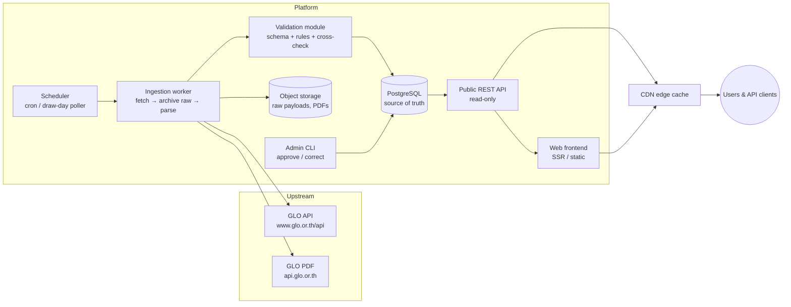
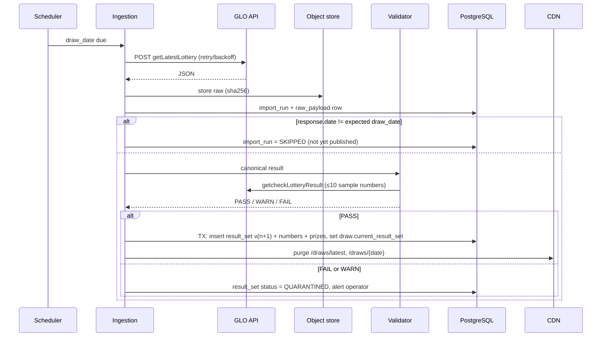

# Phase 2 — System Architecture

Status: **Proposal, awaiting review.** Depends on `docs/research/data-sources.md`.

## 1. Requirements and constraints

| Area | Requirement |
|---|---|
| Scope | Informational only. **No** purchasing, betting, payments, odds, "lucky number" tips or affiliate links |
| Data volume | Tiny: about 24 draws/year × about 173 numbers = about 4,200 rows/year. Full history (2011–) is under 100k rows |
| Write pattern | About 2 writes/month, bursty on draw day, plus a one-off backfill |
| Read pattern | Very spiky. Traffic peaks on draw afternoons. Almost every read hits the latest draw, which is immutable once verified |
| Upstream | One unauthenticated GLO API. Unreliable connections, no SLA, schema drift possible |
| Licence | CC Non-Commercial. Attribution and non-commercial operation required (see the research doc) |
| Trust | Users must be able to see where each result came from, whether it is verified, and whether it was corrected |

**Main design consequence:** this is a read-heavy, almost static dataset, so it should be **cache-first**. CDN-cached HTTP responses make high read traffic cheap. A small relational database is the source of truth. A queue, microservices or a dedicated cache cluster would add nothing at this scale.

## 2. Logical architecture



### Components

1. **Ingestion worker** (scheduled job, not a long-running service).
   - Fetches with retry and backoff (exponential backoff, jitter, at most 5 attempts) and a polite User-Agent.
   - **Archives every raw response** (body plus SHA-256 hash plus request descriptor) **before** parsing. Byte-identical repeats are de-duplicated by hash.
   - Parses into a canonical model through a **source adapter** (`GloApiAdapter`). Adding another source later means writing a new adapter.
   - Writes a new `result_set` version inside one transaction (see the database design).
2. **Validation module** (a library called by ingestion, not a separate service). See §4.
3. **Public REST API** (read-only, stateless). See §5.
4. **Web frontend**: latest result, archive browsing, a number checker, and a source/verification badge on every draw.
5. **Admin CLI**: approve quarantined imports, record corrections, re-run verification. No admin web UI in the MVP, which keeps the attack surface small.
6. **Scheduler**:
   - **Draw-day poller**: on scheduled draw dates, poll `getLatestLottery` every 5 minutes from 14:00 to 18:00 ICT, then hourly until verified.
   - **Daily reconciliation**: re-fetch the last 6 draws through `getLotteryResult` and diff them against stored data to detect upstream corrections.
   - **Weekly**: re-fetch a random sample of 10 historical draws to detect drift.

## 3. Draw-day ingestion flow



## 4. Validation

Validation runs in layers. Each check writes a row to the `verification_check` table.

| Layer | Checks | Severity |
|---|---|---|
| 1. Envelope | `status==true`, `statusCode==200`, expected keys present, JSON schema (strict, unknown keys logged) | FAIL |
| 2. Structural | Every value matches `^\d{n}$` with the right length for its category. Per-category count matches the **prize-structure era** (modern: 1/5/10/50/100/2/2/2/1; legacy: last3f=0, last3b=4) | FAIL |
| 3. Semantic | No duplicates within a category. `near1 == {first-1, first+1}` (wrap-around at 000000/999999 is unverified, so it raises WARN). `date` is on the draw calendar. Prize amounts equal the expected amounts for the era | FAIL / WARN |
| 4. Cross-source | `getcheckLotteryResult` for: first prize, one near1, one 2nd-prize number, a synthetic number ending in last2, and one known non-winner. GLO's verdict must match the local checker | FAIL |
| 5. Temporal | If a verified version already exists and the new payload differs, raise a **correction candidate** and quarantine it for a human to review. Never overwrite silently | WARN |

Verification status of a result set: `PENDING → VERIFIED | QUARANTINED → (APPROVED by admin) VERIFIED | REJECTED`. Only VERIFIED sets are served by default. The API exposes the status so clients can show "unverified" if an operator force-publishes.

## 5. Public REST API (read-only)

Base path `/api/v1`. Responses are JSON, every request is GET, and nothing is authenticated. An optional API key can be added later for higher rate limits.

| Method & path | Description | Cache-Control (edge) |
|---|---|---|
| `GET /draws/latest` | Latest verified draw | `s-maxage=60, stale-while-revalidate=600` |
| `GET /draws?year=2025&cursor=…&limit=…` | Paginated draw list (date, status, first prize) | `s-maxage=3600` |
| `GET /draws/{yyyy-mm-dd}` | Full result for one draw, plus source metadata and version | `s-maxage=86400` once verified and older than 7 days, otherwise 300 |
| `GET /draws/{yyyy-mm-dd}/versions` | Correction history | `s-maxage=3600` |
| `GET /draws/{yyyy-mm-dd}/check?numbers=123456,654321` | Check up to 10 six-digit numbers | `s-maxage=86400` (deterministic per draw version) |
| `GET /prize-categories` | Category definitions and match rules by era | `s-maxage=86400` |
| `GET /health` | Liveness and readiness (no cache) | `no-store` |

Conventions:
- Every draw response carries `source` (name, URL, licence, fetched_at), `verification_status`, `version` and `attribution`.
- Errors use RFC 9457 `application/problem+json`.
- An `ETag` on each draw response is derived from `result_set.id`.
- Draw dates use ISO 8601 (Gregorian). A `display_date_th` field gives the Buddhist-Era date.
- An OpenAPI 3.1 spec is generated from the code and published at `/api/v1/openapi.json`.
- Rate limiting happens at the edge (per-IP token bucket) plus a cheap in-app guard.

### Matching rules (local checker)

A six-digit ticket can win several categories at once, and the prizes add up. Rules are data-driven from the `prize_category.match_type` column:

| Category | match_type | Rule |
|---|---|---|
| first, second, third, fourth, fifth, near1 | `EXACT6` | ticket == number |
| last3f | `PREFIX3` | ticket[0:3] == number |
| last3b | `SUFFIX3` | ticket[3:6] == number |
| last2 | `SUFFIX2` | ticket[4:6] == number |

The local checker is a pure function `(draw_numbers, ticket) → wins[]`. It is unit-tested exhaustively and cross-checked against GLO's checker during ingestion.

## 6. Caching strategy

1. **CDN (primary)**. Responses are public and cacheable, and there are no cookies on API or web responses. On draw day, ingestion **purges** `latest` and the draw's paths; everything else just expires.
2. **App-level in-memory LRU** holds the latest draw and the parsed draws (about 200 KB for the whole history). This protects the DB during a cache stampede, and the DB is only touched on misses.
3. **No Redis in the MVP.** Add it only if horizontal scaling makes per-instance memory caches inconsistent, which they cannot really be, since verified data is immutable per version.
4. **Frontend pages**: archive pages are static or ISR with long TTLs. The latest page revalidates every 60 s.

Capacity estimate [ASSUMPTION]: with a 99% CDN hit ratio, even 5,000 req/s at peak becomes about 50 origin req/s, which one small instance can serve from memory.

## 7. Error handling

| Failure | Behaviour |
|---|---|
| GLO unreachable or reset | Retry 5× with backoff. Mark the import_run FAILED and retry on the next schedule tick. Alert if the draw is still unpublished 3 h after the expected time |
| GLO returns `null` for the expected date | Not an error before the publication window ends. After it, raise a WARN alert (possible postponed draw) |
| Schema drift (unknown or missing keys) | Missing key: FAIL and quarantine. Unknown key: log it and continue (the raw payload is kept anyway) |
| Validation FAIL | Quarantine, alert, keep serving the previous verified state, and show "results pending verification" on the UI |
| Upstream correction | A new version is quarantined. After admin approval it becomes current, the old version stays readable, and the UI shows a "corrected" badge |
| API internal error | 500 problem+json with a correlation ID. The CDN serves stale content (`stale-if-error`) |
| Invalid user input | 400 with field-level problem details. Numbers must match `^\d{6}$` |

## 8. Monitoring and observability

- **Structured JSON logs** with a correlation ID per request and per import_run.
- **Metrics** (Prometheus format): `ingest_runs_total{status}`, `ingest_latency_seconds`, `upstream_errors_total{kind}`, `validation_failures_total{check}`, `draw_publication_delay_seconds`, HTTP RED metrics, and cache hit ratio (from CDN analytics).
- **Alerts**:
  - The draw was not verified by T+3h.
  - A validation FAIL occurred.
  - An upstream correction was detected.
  - Upstream errors exceeded 50% over 1 h.
  - The API 5xx rate exceeded 1%.
- **Synthetic check**: an external uptime probe on `/health` and `/draws/latest`.
- Error tracking with Sentry or an equivalent (the free tier is fine).

## 9. Technology stack options

### Option A — TypeScript full-stack
- **Web**: Next.js (App Router, SSR/ISR)
- **API**: Fastify (or Next route handlers), with Zod schemas → OpenAPI
- **DB**: PostgreSQL 16, using Drizzle ORM plus SQL migrations
- **Jobs**: Node worker run by cron (systemd timer, Kubernetes CronJob or platform scheduler)
- **Tests**: Vitest, Playwright for E2E, Testcontainers for Postgres

### Option B — Python API + lightweight frontend
- **API and jobs**: FastAPI with Pydantic v2 and SQLAlchemy 2 plus Alembic. Ingestion is a Python CLI run by cron
- **Web**: either server-rendered Jinja2 + htmx, or a separate Vite/React SPA
- **DB**: PostgreSQL 16
- **Tests**: pytest, Testcontainers, Playwright

### Comparison

| Criterion | A: TypeScript | B: Python |
|---|---|---|
| One language, shared types (validation schemas reused by API, worker and UI) | ✅ Zod schemas shared end to end | ⚠️ Pydantic on the server only. The SPA needs generated types |
| SEO and SSR for result pages (important for organic traffic) | ✅ Next.js ISR is a strong fit for "static until a new draw" | ✅ with Jinja/htmx, ⚠️ if SPA |
| Data validation and ETL ergonomics | ✅ Good (Zod) | ✅ Excellent (Pydantic, rich data tooling) |
| OpenAPI generation | ✅ via zod-to-openapi / Fastify | ✅ built in (FastAPI) |
| Operational footprint | 1 runtime | 1 runtime (Jinja) or 2 (SPA) |
| Hiring and maintainability | Very common | Very common |
| Thai locale and date handling (BE calendar) | `Intl.DateTimeFormat('th-TH-u-ca-buddhist')` built in | `babel` / manual |

### Recommendation: **Option A (TypeScript)**

Reasons:

1. **One validation schema everywhere.** The canonical draw model, the GLO payload schema and the API response schema live in one shared package. The same schema code validates ingestion, serves the API and types the UI, which removes a whole class of drift bugs.
2. **Next.js ISR fits the data.** Result pages are static until a draw changes. On-demand revalidation triggered by ingestion fits that perfectly, and CDN-friendly SSR suits SEO for queries like "ผลสลาก 16 พฤศจิกายน 2569".
3. **Built-in Buddhist-calendar formatting** through `Intl`.
4. **One runtime** to deploy, monitor and patch.

Option B is equally valid if the team is stronger in Python. The architecture above does not depend on the language.

### Proposed repository layout (monorepo, pnpm workspaces)

```
apps/
  web/            Next.js frontend (+ /api/v1 route handlers OR proxy to api)
  api/            Fastify read-only REST API
  worker/         Ingestion CLI + scheduler entrypoints
packages/
  domain/         Canonical model, prize rules, checker (pure, 100% unit-tested)
  glo-adapter/    GLO API client + payload schemas + mapper
  db/             Drizzle schema, migrations, repositories
  validation/     Rule engine
docs/
```

Decision to confirm at review: API inside Next.js route handlers (fewer deployables) or a separate Fastify app (cleaner separation and independent scaling). **Recommended: a separate `api` app.** It keeps the public API contract independent of the frontend framework, and both apps are cheap to run.

## 10. Deployment

- **Containers**: three images (web, api, worker), built by CI.
- **Hosting**: any of these works:
  - (a) a managed container platform (Fly.io, Render, Cloud Run) plus managed Postgres, or
  - (b) a single small VM with Docker Compose for early stages.
  - [RECOMMENDATION] Use (a) with Cloud Run or similar. It scales to zero off-peak and auto-scales on draw day, and managed Postgres comes with PITR backups.
- **CDN**: Cloudflare (or the platform's CDN) in front of web and API, with purge-by-URL from the worker.
- **Region**: Singapore (closest major region to Thailand).
- **Environments**:
  - `dev`: local Docker Compose with a recorded GLO fixture server, so tests never hit GLO.
  - `staging`: hits the real GLO at a reduced cadence.
  - `prod`
- **CI/CD** (GitHub Actions): lint, typecheck, unit, integration (Testcontainers), E2E against staging, then a manual approval to deploy to prod. DB migrations run as a separate pre-deploy step.
- **Backups**: managed Postgres PITR. The object store holding raw payloads and PDFs is versioned. Because raw payloads are kept, the DB can be rebuilt from them.
- **Secrets**: the platform's secret manager. The only secrets are the DB URL and the CDN purge token.

## 11. Security and compliance

- Read-only public surface. Admin actions go through the CLI, which needs DB credentials, and have no public endpoint.
- Strict input validation. Parameterised queries via the ORM. CSP headers on the web app.
- No user accounts and no PII in the MVP. Checked numbers are **not logged with IPs**, and only aggregate counts are kept.
- Responsible-gambling notice and links in the footer. Plain statement: "Information only, not affiliated with GLO. Always verify with GLO."
- GLO attribution and licence notice on every page and in every API response.

## 12. Out of scope (MVP)

- N3 three-digit lottery results. The raw payload is stored, so support can be added later.
- PDF parsing.
- User accounts, notifications and push alerts.
- Any commercial feature (blocked by the licence anyway).
