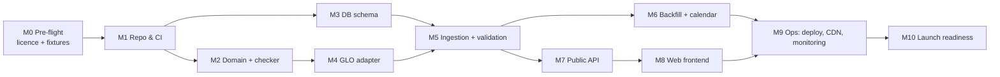

# Phase 4 — Implementation Roadmap

Status: **Proposal, awaiting approval. No implementation has started.**
Assumes the recommended stack: TypeScript monorepo, Next.js, Fastify, PostgreSQL, Drizzle (see `docs/architecture/system-design.md`).

## Global Definition of Done (applies to every milestone)

- Code is merged to the main branch through a PR with at least one review, and CI is green: lint, typecheck, unit and integration tests.
- New logic has tests. Line coverage is ≥ 90% in `packages/domain` and `packages/validation`, and ≥ 80% elsewhere.
- **No test calls the live GLO API.** Tests use recorded fixtures. Live calls happen only in the staging smoke job.
- Docs are updated: README, ADRs for any decision, and the OpenAPI spec where relevant.
- No secrets in the repo. Dependencies are pinned and the lockfile is committed.
- Every milestone can be demoed on its own.

## Milestone overview

---

### M0 — Pre-flight (no code)
**Deliverables**
- Email to GLO (`callcenter@glo.or.th`) asking about permitted use, attribution, rate limits, and re-serving the data through a public API.
- A recorded fixture set, collected **once** at ≤ 1 request every 5 s:
  - latest draw,
  - about 10 historical draws covering both prize-structure eras,
  - one `null` date,
  - three check responses.
- ADR-001: stack choice. ADR-002: non-commercial operating policy.

**Acceptance criteria**: the fixtures are committed with their fetch timestamps and hashes, and the email is sent (a reply is *not* needed to continue development, but **is needed before public launch**).
**Dependencies**: none. **Risk**: GLO does not reply. Mitigation: launch stays blocked, while development continues.

### M1 — Repository skeleton and CI
**Deliverables**:
- pnpm monorepo (`apps/web`, `apps/api`, `apps/worker`, `packages/*`),
- ESLint, Prettier and strict TypeScript,
- Vitest,
- GitHub Actions workflow,
- Docker Compose with Postgres,
- `.env.example`.

**Acceptance criteria**: `pnpm i && pnpm test && pnpm build` passes in CI on a clean checkout, and `docker compose up` starts Postgres.
**Testing**: a trivial test in each package proves the pipeline works.

### M2 — Domain model and checker (`packages/domain`)
**Deliverables**:
- canonical types (`Draw`, `ResultSet`, `PrizeCategory`, `PrizeStructure`),
- a pure `checkTicket(resultSet, ticket) → Win[]`,
- Buddhist-Era date formatting helpers.

**Acceptance criteria**
- All match types are covered: EXACT6, PREFIX3, SUFFIX3 and SUFFIX2.
- One ticket can hold multiple wins (for example 2nd prize plus last2), and the total amount is computed.
- Input that is not exactly six digits is rejected.
- Leading zeros are preserved (`"000079"`).
- Both eras are handled. Under the legacy era there is no `last3f`, and `last3b` has 4 numbers.

**Testing**:
- table-driven unit tests,
- **property-based tests** (fast-check): every published number wins its own category, and a random ticket wins `last2` exactly when its suffix matches,
- golden tests that use the GLO check fixtures (`253603` → first, `000079` → last2, `253602` → near1, `123456` → none for 2024-03-01).

**Dependencies**: M1.

### M3 — Database schema and migrations (`packages/db`)
**Deliverables**:
- Drizzle schema and SQL migrations that implement `database-design.md`, including the triggers (append-only, digit length, current-set consistency),
- seed data for categories and eras,
- repository functions.

**Acceptance criteria**
- Migrations apply cleanly to an empty DB and roll back.
- Triggers reject an UPDATE on `prize_number`, a wrong digit length, and a current pointer to a non-VERIFIED set.
- Inserting a duplicate `(draw_id, version)` fails.

**Testing**: integration tests on Testcontainers Postgres.
**Dependencies**: M1.

### M4 — GLO adapter (`packages/glo-adapter`)
**Deliverables**:
- an HTTP client for the 3 endpoints, with timeouts, retry (exponential backoff with jitter, at most 5 attempts), a User-Agent and a global rate limiter (≤ 1 req/5 s),
- Zod schemas for both envelope variants,
- a mapper from payload to canonical model,
- a `null`-response handler that returns `NotPublished`.

**Acceptance criteria**
- Every fixture parses.
- A deliberately mutated fixture (missing key, wrong type) fails with a typed error.
- An unknown extra key is tolerated and reported.
- `n3` is preserved in `source_meta` but not mapped.
- `round` is mapped to `draw_order`.

**Testing**: unit tests against the fixtures, and retry tests against a local mock server (msw/nock) that simulates connection resets and 5xx errors.
**Dependencies**: M2.

### M5 — Ingestion and validation (`apps/worker`, `packages/validation`)
**Deliverables**:
- validation rule engine with all 5 layers (system design §4),
- `ingest latest`, `ingest date <yyyy-mm-dd>` and `reconcile` CLI commands,
- the transactional import (database design §6),
- quarantine flow,
- admin CLI: `review`, `approve`, `reject`, `correct`,
- a CDN purge hook (a no-op locally).

**Acceptance criteria**
- Re-importing an identical payload creates **no** new version.
- A changed payload for an already-verified draw creates version 2 in QUARANTINED and leaves the current pointer unchanged. Running `approve` creates a `correction` row, moves the pointer and writes `audit_log`.
- Each validation failure (bad count, bad near1, cross-check mismatch) quarantines the import and records `verification_check` rows.
- An upstream outage leaves the DB unchanged and marks `import_run` FAILED.

**Testing**: integration tests (Testcontainers plus a mock GLO server) covering the scenario matrix above.
**Dependencies**: M3, M4.

### M6 — Draw calendar and historical backfill
**Deliverables**:
- a curated draw calendar, seeded by probing candidate dates for each month (1, 2, 16, 17, 30, 31 and the days next to them) with **early exit once a draw is found**,
- a resumable, rate-limited backfill command,
- an era-boundary detection report.

**Acceptance criteria**
- A backfill run against staging completes from the earliest available draw to the present, and can be resumed after being killed.
- Every imported draw is VERIFIED or explicitly quarantined, with a report.
- The earliest covered draw and the first `last3f` draw are recorded in `docs/research/data-sources.md` (this closes open questions 4 and 6).

**Testing**: a dry-run mode against the fixtures, then one supervised staging run.
**Risk**: the probe volume is roughly 15 years × 24 draws × about 2 probes ≈ 700 requests, which at 5 s each is about 1 hour. Run it once, off-peak.
**Dependencies**: M5.

### M7 — Public REST API (`apps/api`)
**Deliverables**:
- the endpoints listed in system design §5,
- an OpenAPI 3.1 spec served at `/api/v1/openapi.json`,
- `problem+json` errors,
- ETag and Cache-Control headers,
- the in-memory LRU cache,
- per-IP rate limiting,
- `/health`.

**Acceptance criteria**
- The responses match the OpenAPI spec (contract tests).
- `/draws/{date}/check` gives the same results as `checkTicket`.
- Unverified result sets are never returned as `current`.
- Attribution and licence fields appear in every draw response.
- p95 latency is under 50 ms at 200 req/s on a warm cache (local k6 test).

**Testing**: Supertest/inject integration tests, schema contract tests and a k6 smoke load test.
**Dependencies**: M5. It can start against seeded data before M6.

### M8 — Web frontend (`apps/web`)
**Deliverables**:
- pages: latest result, archive (by year), draw detail, number checker, about/sources/disclaimer,
- Thai as the primary language with English secondary,
- Buddhist-Era dates,
- ISR, with on-demand revalidation triggered by the worker,
- verification and correction badges,
- responsible-gambling notice.

**Acceptance criteria**
- Lighthouse scores ≥ 90 for performance and accessibility on mobile.
- The checker works with JS disabled (server-side form).
- WCAG 2.1 AA basics are met.
- No purchasing, betting or advertising elements anywhere.

**Testing**: component tests and Playwright E2E (view latest, browse archive, check a winning and a losing number, see a corrected draw).
**Dependencies**: M7.

### M9 — Deployment, CDN and monitoring
**Deliverables**:
- container images,
- staging and prod on the chosen platform, with managed Postgres and PITR,
- CDN with purge integration,
- scheduler (draw-day poller, daily reconcile, weekly drift sample),
- metrics, alerts (system design §8), Sentry and an uptime probe,
- runbook: draw-day ops, correction handling, GLO outage and schema drift.

**Acceptance criteria**
- Staging ingests a **real live draw** end to end without manual steps.
- An alert fires in a simulated failure drill.
- Restoring from backup is tested once.
- The CDN hit ratio is ≥ 95% in a synthetic load test.

**Dependencies**: M6, M8.

### M10 — Launch readiness
**Acceptance criteria**
- GLO's response to the M0 email has been received and its terms are reflected in the product. **This is a hard gate.**
- Two consecutive live draws are ingested and verified automatically in staging.
- A security review is done (headers, dependency audit, input fuzzing on `/check`).
- Privacy statement and disclaimers are published.

---

## Testing strategy summary

| Level | Tooling | Scope |
|---|---|---|
| Unit | Vitest, fast-check | Checker, validation rules, mappers, date helpers |
| Integration | Testcontainers Postgres, msw/nock GLO mock | Import transactions, triggers, API handlers |
| Contract | OpenAPI schema validation | API responses; GLO payload schemas against fixtures |
| E2E | Playwright | Core user journeys on staging |
| Load | k6 | API and CDN behaviour under draw-day peak |
| Live smoke | Scheduled job (staging only) | One `getLatestLottery` per day to detect upstream drift early |

## Risk register

| # | Risk | Likelihood | Impact | Mitigation |
|---|---|---|---|---|
| R1 | GLO licence or terms forbid re-publication through our API | Med | High | M0 email, launch gate in M10, non-commercial operation, attribution |
| R2 | GLO API schema changes without notice | Med | Med | Strict schema plus tolerant unknown keys, raw archive, drift alerts, daily smoke |
| R3 | GLO API unavailable on draw day | Med | Med | Retry/backoff, extended polling window, show a "pending" state, never show unverified data as final |
| R4 | GLO blocks our client (WAF) | Low–Med | High | Low request rate, descriptive UA with contact address, no scraping, ask GLO to allowlist us |
| R5 | Bug in our matching logic misinforms users | Low | High | Property tests, cross-check against GLO's checker on every import, "always verify with GLO" disclaimer |
| R6 | Upstream silently corrects a past draw | Low | Med | Daily reconcile, versioned result sets, correction workflow |
| R7 | Historical prize amounts are wrong | Med | Low | Amounts for the legacy era are NULL/unverified, and the UI labels them as such |
| R8 | Draw-day traffic spike | High | Med | CDN-first design, ISR, load test in M9 |
| R9 | Unknown era boundary and calendar gaps | High | Low | M6 detection report, tests driven by data |

## Suggested first sprint (after approval)

M0 + M1 + M2. These have no external dependency beyond a one-off fixture capture, and they produce the most important correctness asset: a fully tested checker validated against GLO's own answers.
